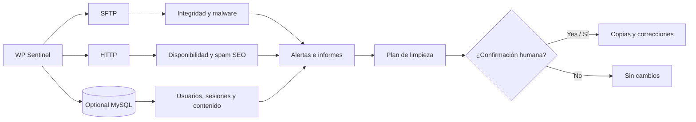

<div align="center">

# 🛡️ WP Sentinel

### Monitoreo externo de seguridad, integridad y limpieza asistida para WordPress

**Protege varios sitios sin instalar plugins ni agentes en los servidores monitoreados.**


**[Português](README.md) · [English](README.en.md) · [Español](README.es.md)**

</div>

> [!IMPORTANT]
> **Los análisis son de solo lectura.** La limpieza asistida es una operación independiente que puede modificar archivos y registros de la base de datos **únicamente después de una confirmación explícita**. Revisa el plan y conserva copias de seguridad confiables antes de aplicar correcciones.

## 📚 Contenido

- [Funciones principales](#section-1)
- [Cómo funciona](#section-2)
- [Inicio rápido](#section-3)
- [Descripción general](#section-4)
- [Instalación y configuración](#section-5)
- [Frecuencia y hashes completos](#section-6)
- [Panel web con Docker](#section-7)
- [Despliegue en VPS (producción)](#section-8)
- [Limpieza asistida](#section-9)
- [Informes y auditoría](#section-10)
- [Códigos de salida](#section-11)
- [Buenas prácticas de seguridad](#section-12)

<a id="section-1"></a>

## 🌟 Funciones principales

| Función | Qué hace WP Sentinel |
|:--|:--|
| 🧬 **Integridad de archivos** | Compara archivos con una línea base, incluyendo hashes SHA-256 periódicos. |
| 🦠 **Detección de malware** | Busca webshells, PHP en ubicaciones sospechosas, marcadores de malware y drop-ins maliciosos. |
| 👤 **Cuentas y sesiones** | Detecta usuarios nuevos, cambios de privilegios, sesiones sospechosas y Application Passwords cuando hay acceso a la base de datos. |
| 🔎 **Spam SEO** | Localiza enlaces externos ocultos en el HTML público y en WordPress/Elementor. |
| 🌐 **Monitoreo HTTP** | Comprueba disponibilidad, redirecciones y cabeceras de seguridad. |
| 🧹 **Limpieza guiada** | Genera un plan, exige confirmación, crea copias de seguridad e identifica tareas para revisión humana. |
| 📁 **Auditoría** | Guarda alertas JSONL e informes técnicos diarios en texto plano. |
| 🖥️ **Panel React** | Interfaz web en Docker que comparte motor y datos con la CLI. |
| 🏢 **Múltiples sitios** | Configura sitios de diferentes proveedores a través de `.env`. |

<a id="section-2"></a>

## 🧭 Cómo funciona



**Flujo:** `Configurar sitios` → `Ejecutar análisis` → `Revisar alertas` → `Inspeccionar plan` → `Confirmar limpieza si corresponde` → `Volver a analizar`.

<a id="section-3"></a>

## ⚡ Inicio rápido

**Requisitos:** Node.js 20+ para ejecución local; Docker y Docker Compose para el panel en contenedor.

```bash
# 1. Prepare a configuração (Windows PowerShell)
Copy-Item .env.example .env

# 2. Edite o .env com os sites, credenciais e caminhos corretos

# 3. Instale as dependências (execução local)
npm install

# 4. Execute uma verificação inicial
npm run scan:full

# 5. Opcional: inicie o painel em Docker
docker compose up -d --build
```

> [!TIP]
> El primer análisis registra el estado actual como línea base; **esto no implica que sea confiable**. Revisa las alertas y valida el entorno antes de ejecutar `npm run reset-baseline`.

---

<a id="section-4"></a>

## ✨ Descripción general

WP Sentinel es un **monitor externo, sin agentes y de solo lectura durante los análisis** para sitios WordPress. Los sitios, rutas, credenciales SFTP y conexiones opcionales a bases de datos se definen en `.env`, sin valores fijos en el código. Comprueba:

- Archivos ejecutables nuevos, modificados o eliminados mediante SFTP, y **todos** los cambios en `wp-content/mu-plugins`, incluso archivos sin extensión.
- Marcadores de malware en la raíz de WordPress, `wp-content` y `mu-plugins`: `sc_XXXXXX`, `scgXXXXXX`, `z`, `.sc_*`, `.kk_*`, `.gk_*`, `.gt_*`, `.grd_*`, `.sd_*`, `.bt_*`, `.swm_*`, `.rd_*` (hasta 64 bytes). Generan alertas críticas por directorio. La regla está en `src/malware-markers.mjs` y se reutiliza en la limpieza.
- PHP en `uploads`, archivos PHP ocultos, nombres peligrosos y firmas de webshell.
- Drop-ins (`wp-content/db.php`, `advanced-cache.php`, `object-cache.php`) y PHP suelto en `wp-content/cache/` (se excluyen los subdirectorios de plugins de caché). `src/dropins.mjs` reconoce plugins conocidos (W3 Total Cache, WP Super Cache, LiteSpeed, Redis Object Cache, Query Monitor, etc.), orígenes desconocidos y firmas maliciosas u ofuscación. Los archivos maliciosos generan alertas críticas en cada ciclo; los de origen desconocido generan alertas altas al aparecer o cambiar; los drop-ins legítimos conocidos no generan alertas.
- Sesiones de acceso (`session_tokens`): cada sesión nueva genera una alerta alta; si procede de la IP del propio servidor o tiene un navegador `WordPress/...` o vacío, genera una crítica. Las IP del servidor se obtienen de los dominios, `SFTP_HOST`, `DB_HOST` y la variable opcional `SERVER_IPS`.
- **Spam SEO oculto:** enlaces a otros dominios dentro de bloques `position: fixed/absolute` con coordenadas de −100 px o menores. Comprueba el HTML de inicio como navegador y como Googlebot, y `_elementor_data` y `post_content` de páginas, entradas y plantillas en la base de datos. Las alertas críticas indican páginas, widgets y dominios. Regla en `src/hidden-links.mjs`.
- Disponibilidad HTTP, redirecciones entre dominios, cabeceras de seguridad y bloqueo de `xmlrpc.php` y PHP ejecutable en `uploads`.
- Usuarios y privilegios, Application Passwords, sesiones, entradas nuevas, plugins activos, dominios configurados y WP-Cron cuando se permite la conexión MySQL remota.

El monitoreo no modifica archivos ni bases de datos. Las alertas se guardan en `.monitor-data/alerts.jsonl`; **solo la limpieza asistida confirmada por separado puede efectuar cambios**.

> [!NOTE]
> Los archivos volátiles `wp-content/uploads/sucuri/sucuri-*.php` se excluyen de la comparación de hashes. Cualquier otro PHP en `uploads` sigue siendo crítico y la ejecución web en esa carpeta se comprueba en cada ciclo.

<a id="section-5"></a>

## 🚀 Instalación y configuración

1. Instala **Node.js 20 o superior**.
2. Copia `.env.example` a `.env`.
3. En `SITES`, enumera los prefijos, por ejemplo `SITES=TIENDA,BLOG`. Configura `<PREFIX>_NAME`, `<PREFIX>_URL` y `<PREFIX>_REMOTE_ROOT` (carpeta del WordPress que contiene `wp-config.php`) para cada uno. Consulta el ejemplo completo en `.env.example`.
4. Configura las credenciales SFTP predeterminadas (`SFTP_*`); los sitios en otro alojamiento pueden usar `<PREFIX>_SFTP_*`. Utiliza acceso de solo lectura cuando sea posible.
5. Opcionalmente, configura `<PREFIX>_DB_*`. En HostGator/cPanel podría ser necesario autorizar la IP en **MySQL remoto**. Escribe entre comillas simples las contraseñas que contengan `$` o `#`.
6. Ejecuta `run-scan.cmd` para un análisis único o `run-monitor.cmd` para monitoreo continuo.

Para agregar o quitar sitios, actualiza su bloque y la lista `SITES`. El primer análisis guarda el estado actual. **No cambies `<PREFIX>_KEY` de un sitio con historial**: conecta el sitio con sus datos en `.monitor-data`.

<a id="section-6"></a>

## ⏱️ Frecuencia y hashes completos

| Ajuste / comando | Funcionamiento |
|:--|:--|
| `INTERVAL_SECONDS` (predeterminado `300`) | Tiempo entre el final de un ciclo de monitoreo y el inicio del siguiente. |
| `FULL_HASH_EVERY` (predeterminado `24`) | Cada N ciclos vuelve a descargar y calcular SHA-256 de todos los archivos monitoreados, detectando cambios que conservan tamaño y fecha. En otros ciclos solo descarga los nuevos o modificados según sus metadatos. Con 300 segundos, aproximadamente cada 4 horas. |
| `npm run scan:full` | Fuerza un análisis completo único fuera de la programación normal. |
| `MAX_DOWNLOAD_BYTES` (predeterminado `8 MiB`) | No descarga archivos mayores para cálculo de hash o inspección. |

El contador también incluye las ejecuciones de `run-scan.cmd`. Los ciclos completos (incluido el primero de cada sitio) pueden tardar más del doble; las pausas prolongadas mientras se inventarían archivos son normales. La consola señala cuando está ejecutando el hash completo.

<a id="section-7"></a>

## 🖥️ Panel web con Docker

El panel **React SPA** utiliza una compilación Docker multi-stage (Node.js 22 y archivos estáticos optimizados) y comparte el mismo motor CLI y los directorios de datos locales.

### Comandos del contenedor

```bash
# Compilar e arrancar el panel en segundo plano
docker compose up -d --build

# Seguir registros del servidor, análisis y daemon
docker compose logs -f

# Comprobar el estado del contenedor
docker compose ps

# Detener el panel conservando volúmenes e historial
docker compose down
```

Dirección del panel: **<http://127.0.0.1:8787>** (o el puerto indicado en `PANEL_PORT`).

### Volúmenes y persistencia

`docker-compose.yml` monta tres ubicaciones del host:

| Montaje | Función |
|:--|:--|
| `./.env:/app/.env` | Configuración de sitios y credenciales; debe existir antes de iniciar el contenedor. |
| `${DATA_DIR:-./.monitor-data}:/app/.monitor-data` | Historial, `trusted-baseline.json`, `state.json`, `alerts.jsonl`, copias en `backups/` y `panel-notifications.json`. |
| `${REPORTS_DIR:-./reports}:/app/reports` | Informes técnicos diarios TXT y resúmenes ejecutivos. |

> [!NOTE]
> Los scripts CLI (`run-scan.cmd`, `run-monitor.cmd`, `run-cleanup.cmd`) y el panel comparten los datos. **No ejecutes simultáneamente el monitor continuo local y el monitor del panel.**

### 🔐 Seguridad del panel

- **Acceso local (loopback):** `PANEL_HOST=127.0.0.1` por defecto; solo se aceptan conexiones locales y no se exige contraseña.
- **Acceso por red / VPS:** con `PANEL_HOST` fuera del loopback (por ejemplo, `0.0.0.0`), el servidor no arranca sin `PANEL_PASSWORD`. La autenticación usa HMAC firmado, cookies seguras HTTP-only y limitación de intentos contra fuerza bruta.

---

<a id="section-8"></a>

## ☁️ Despliegue en VPS (producción)

WP Sentinel puede ejecutarse localmente o en una VPS/servidor Linux (Ubuntu 22.04/24.04 LTS o Debian 12, arquitecturas `amd64` y `arm64`). Para monitoreo 24/7, utiliza un host permanentemente encendido.

### 1. Preparar la VPS Linux

Instala Docker Engine y el complemento oficial Docker Compose (los comandos siguientes son para Ubuntu):

```bash
# Actualizar repositorios e instalar dependencias
sudo apt-get update && sudo apt-get install -y ca-certificates curl gnupg ufw

# Agregar el repositorio oficial de Docker
sudo install -m 0755 -d /etc/apt/keyrings
curl -fsSL https://download.docker.com/linux/ubuntu/gpg | sudo gpg --dearmor -o /etc/apt/keyrings/docker.gpg
sudo chmod a+r /etc/apt/keyrings/docker.gpg
echo "deb [arch=$(dpkg --print-architecture) signed-by=/etc/apt/keyrings/docker.gpg] https://download.docker.com/linux/ubuntu $(. /etc/os-release && echo "$VERSION_CODENAME") stable" | sudo tee /etc/apt/sources.list.d/docker.list > /dev/null

# Instalar Docker Engine y Compose
sudo apt-get update && sudo apt-get install -y docker-ce docker-ce-cli containerd.io docker-compose-plugin
```

### 2. Copiar el proyecto y los datos

Clona el repositorio o copia sus archivos a `/opt/wp-sentinel`:

```bash
# Ejemplo con Git o rsync
mkdir -p /opt/wp-sentinel
cd /opt/wp-sentinel
git clone <URL_DEL_REPOSITORIO> .
```

Copia de forma segura el `.env` de producción y el historial `.monitor-data/`, y restringe los permisos:

```bash
# Restringir permisos
chmod 600 .env
chmod -R 700 .monitor-data
```

### 3. Configurar `.env` de producción

```env
# Puerto Docker para el proxy inverso
PANEL_HOST=0.0.0.0
PANEL_PORT=8787

# OBLIGATORIO fuera del loopback: contraseña segura del panel
PANEL_PASSWORD=REEMPLAZAR_CON_CONTRASENA_SEGURA_Y_UNICA

# Iniciar monitoreo continuo al arrancar el contenedor
MONITOR_AUTOSTART=true
```

### 4. Proxy inverso HTTPS (Caddy)

Sitúa **Caddy** delante de WP Sentinel para obtener certificados TLS automáticos y compatibilidad con WebSocket y Server-Sent Events (SSE). Instálalo con `sudo apt install -y caddy` y edita `/etc/caddy/Caddyfile`:

```caddy
sentinel.example.com {
    # Redirigir el tráfico al puerto 8787 del contenedor
    reverse_proxy 127.0.0.1:8787 {
        # Streaming SSE sin búfer
        flush_interval -1
    }

    # Cabeceras HTTP de seguridad recomendadas
    header {
        Strict-Transport-Security "max-age=31536000; includeSubDomains; preload"
        X-Content-Type-Options "nosniff"
        X-Frame-Options "DENY"
        Referrer-Policy "strict-origin-when-cross-origin"
    }
}
```

Recarga Caddy:

```bash
sudo systemctl reload caddy
```

### 5. Configurar firewall (UFW)

Permite únicamente los puertos necesarios. Confirma el acceso SSH antes de activar UFW:

```bash
# Permitir SSH, HTTP y HTTPS
sudo ufw default deny incoming
sudo ufw default allow outgoing
sudo ufw allow 22/tcp comment 'SSH'
sudo ufw allow 80/tcp comment 'HTTP (Caddy LetEncrypt)'
sudo ufw allow 443/tcp comment 'HTTPS (Caddy)'

# Activar firewall (puerto 8787 protegido por Caddy/localhost)
sudo ufw enable
```

### 6. Autorizar la IP de la VPS en MySQL remoto (cPanel)

Si se consultan bases de datos WordPress a través del puerto 3306:
1. Abre **cPanel** para cada alojamiento.
2. Ve a **Bases de datos → MySQL remoto**.
3. Autoriza la dirección IPv4 pública fija de tu VPS.
4. Sin autorización, puede producirse el error `ER_ACCESS_DENIED_ERROR` (1045).

### 7. Actualizaciones y respaldos

Para actualizar WP Sentinel:

```bash
cd /opt/wp-sentinel
git pull
docker compose up -d --build
```

Copia de seguridad diaria recomendada en crontab para `.monitor-data` y `reports`:

```bash
# Copia diaria de .monitor-data y reports
0 3 * * * tar -czf /var/backups/sentinel-backup-$(date +\%F).tar.gz -C /opt/wp-sentinel .monitor-data reports
```

---

<a id="section-9"></a>

## 🧹 Limpieza asistida

Ejecuta `run-cleanup.cmd` después de revisar las alertas. La herramienta:

1. Crea `.monitor-data/last-cleanup-plan.json`.
2. Separa las correcciones automáticas de las que requieren revisión humana.
3. Exige la frase de confirmación única `LIMPAR-ID-DO-PLANO` antes de aplicar cambios.
4. Ejecuta las modificaciones de la base de datos dentro de transacciones.

Usa `npm run plan` para crear y revisar el plan **sin ejecutar la limpieza**.

Puede eliminar drop-ins y PHP suelto en `wp-content/cache/` cuando se clasifican como maliciosos; los de origen desconocido se revisan manualmente. Cada archivo eliminado se respalda en `.monitor-data/backups/`.

En la base de datos puede eliminar opciones de malware (`sc_*`, copias con nombres hexadecimales y `wpeditor_*`), plugins maliciosos que sigan en la lista de activos y el snippet **Site Optimizer Bridge** de Code Snippets. Todas las operaciones generan copias en `.monitor-data/backups/`. Solo se eliminan usuarios automáticamente cuando existen usuarios en la línea base confiable; en caso contrario se requiere revisión humana.

Se admiten fechas de corte por sitio `<PREFIX>_SPAM_SINCE_POST` y `<PREFIX>_SPAM_SINCE_PAGE` para borrar entradas y páginas creadas a partir de ellas como spam. **Defínelas únicamente tras comprobar que no hay contenido legítimo en ese período.**

Las acciones automáticas se limitan a indicadores de alta confianza: archivos maliciosos nuevos fuera de la línea base, usuarios nuevos, Application Passwords, registro público, `wpse_user_id`, hooks de cron maliciosos conocidos, dominios alterados y archivos marcadores de malware (hasta 64 bytes) en la raíz, `wp-content` y `mu-plugins`. La limpieza también cierra **todas las sesiones** (`session_tokens`) de los sitios afectados, incluidas las legítimas; será necesario volver a iniciar sesión. Los archivos que ya existían en la línea base, entradas nuevas y hooks de cron desconocidos nunca se eliminan automáticamente porque podrían ser legítimos.

### Spam SEO: enlaces externos ocultos

Cuando se detectan enlaces externos ocultos, la limpieza:

1. Guarda `_elementor_data`, `post_content`, caché de Elementor y revisiones afectadas en `.monitor-data/backups/<plan>-<site>-*.json`.
2. Elimina únicamente los bloques ocultos sin volver a codificar innecesariamente el resto del contenido; quita los widgets HTML completamente vacíos creados por el atacante.
3. Borra `_elementor_element_cache` de las páginas afectadas (Elementor lo reconstruye).
4. Elimina revisiones que aún contienen enlaces ocultos para evitar su restauración accidental.
5. Verifica el HTML publicado como navegador y como Googlebot.

Si no es seguro editar una página, no la modifica y la envía a revisión manual. Después de limpiar, ejecuta `run-scan.cmd`.

La primera línea base refleja el estado inicial del servidor; las firmas maliciosas siguen detectándose. **Utiliza `npm run reset-baseline` solamente tras verificar que el estado remoto es confiable**; también sustituye la línea base usada por la limpieza.

<a id="section-10"></a>

## 📄 Informes y auditoría

Cada análisis único y limpieza agrega una sección en `reports/REPORT-DD.MM.AA.txt`, con **fecha de Brasilia**. Los siguientes eventos del día añaden secciones numeradas (por ejemplo `reports/REPORT-23.10.26.txt`).

- `run-scan.cmd`: siempre registra archivos, HTTP, base de datos y alertas por sitio.
- `run-monitor.cmd`: solo registra ciclos con alertas altas o críticas, evitando informes innecesarios cada cinco minutos.
- `run-cleanup.cmd`: siempre registra, incluso si no hay acciones, se cancela la confirmación o hay un error; incluye acciones por sitio, comprobaciones, revisiones manuales y copias. `npm run plan` no genera un informe.

Los informes pueden contener nombres de usuario, direcciones IP y rutas del servidor. Consérvalos de forma privada. La carpeta `reports/` está ignorada por Git.

<a id="section-11"></a>

## 🔢 Códigos de salida

| Código | Significado |
|:--|:--|
| `0` | Sin alertas altas ni críticas. |
| `1` | Alerta de gravedad alta. |
| `2` | Alerta crítica o fallo general del análisis. |


<a id="section-12"></a>

## 🔐 Buenas prácticas de seguridad

- **Protege las credenciales:** no publiques `.env`; concede los mínimos privilegios SFTP/MySQL y restringe el acceso a archivos de configuración.
- **Evita exponer el panel directamente:** usa autenticación y HTTPS mediante proxy inverso y comprueba que el puerto Docker está restringido.
- **Protege los datos de auditoría:** `.monitor-data/` y `reports/` pueden contener IP, rutas y datos de usuarios.
- **Valida las alertas:** los cambios legítimos pueden parecer sospechosos; revisa el plan y los respaldos antes de borrar.
- **Evita la concurrencia:** no ejecutes dos monitores continuos sobre los mismos directorios de datos.
- **Verifica la línea base:** el estado inicial puede estar comprometido; no lo consideres confiable sin validación.

<details>
<summary><strong>📌 Referencia rápida de archivos y directorios</strong></summary>

| Ruta | Función |
|:--|:--|
| `.env` | Credenciales y configuración secreta. |
| `.env.example` | Plantilla de configuración. |
| `.monitor-data/alerts.jsonl` | Registro estructurado de alertas. |
| `.monitor-data/trusted-baseline.json` | Línea base confiable para análisis y limpieza. |
| `.monitor-data/state.json` | Estado operativo persistido. |
| `.monitor-data/last-cleanup-plan.json` | Último plan de limpieza. |
| `.monitor-data/backups/` | Copias de seguridad de limpieza. |
| `reports/REPORT-DD.MM.AA.txt` | Informes diarios (hora de Brasilia). |
| `src/malware-markers.mjs` | Reglas de marcadores de malware. |
| `src/dropins.mjs` | Clasificación de drop-ins. |
| `src/hidden-links.mjs` | Detección de enlaces ocultos. |

</details>

---

<div align="center">

**WP Sentinel** · Monitoreo externo · Integridad · Auditoría · Limpieza asistida

<sub>Documentación operativa — mantén privadas las credenciales y los informes.</sub>

</div>
