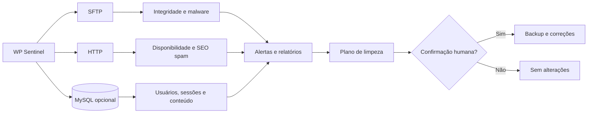

<div align="center">

# 🛡️ WP Sentinel

### Monitoramento externo de segurança, integridade e limpeza assistida para WordPress

**Proteja múltiplos sites sem instalar plugins ou agentes nos servidores monitorados.**


</div>

> [!IMPORTANT]
> As **varreduras são somente leitura**. A **limpeza assistida é uma operação separada**, capaz de alterar arquivos e registros do banco **somente após confirmação explícita**. Faça revisão do plano e mantenha backups confiáveis antes de executar qualquer correção.

## 📚 Índice

- [Visão geral](#-visão-geral)
- [Principais recursos](#-principais-recursos)
- [Como funciona](#-como-funciona)
- [Instalação e configuração](#-instalação-e-configuração)
- [Frequência e hash completo](#️-frequência-e-hash-completo)
- [Painel web com Docker](#️-painel-web-com-docker)
- [Deploy em VPS](#️-deploy-em-vps-produção)
- [Limpeza assistida](#-limpeza-assistida)
- [Relatórios e auditoria](#-relatórios-e-auditoria)
- [Códigos de saída](#-códigos-de-saída)
- [Boas práticas de segurança](#-boas-práticas-de-segurança)

---

## 🌟 Principais recursos

| Recurso | O que o WP Sentinel faz |
|:--|:--|
| 🧬 **Integridade de arquivos** | Compara arquivos monitorados com um baseline, incluindo hashes SHA-256 periódicos. |
| 🦠 **Detecção de malware** | Analisa webshells, PHP em locais suspeitos, marcadores de malware e drop-ins maliciosos. |
| 👤 **Contas e sessões** | Identifica novos usuários, mudanças de privilégios, sessões suspeitas e Application Passwords quando há acesso ao banco. |
| 🔎 **SEO spam** | Procura links externos ocultos no HTML público e no conteúdo armazenado em WordPress/Elementor. |
| 🌐 **Monitoramento HTTP** | Verifica disponibilidade, redirecionamentos e cabeçalhos de segurança. |
| 🧹 **Limpeza guiada** | Gera plano, exige confirmação, cria backups e separa itens que dependem de revisão humana. |
| 📁 **Auditoria** | Armazena alertas em JSONL e produz relatórios técnicos diários em TXT. |
| 🖥️ **Painel React** | Disponibiliza uma interface web executada em Docker, compartilhando dados com a CLI. |
| 🏢 **Múltiplos sites** | Gerencia WordPress em hospedagens diferentes por meio de configurações no `.env`. |

## 🧭 Como funciona



**Fluxo de operação:** `Configurar sites` → `Executar varredura` → `Analisar alertas` → `Revisar plano` → `Confirmar limpeza, se necessário` → `Validar com nova varredura`.

### ⚡ Comece rapidamente

**Pré-requisitos:** Node.js 20+ para execução local; Docker e Docker Compose para o painel em container.

```bash
# 1. Prepare a configuração (Windows PowerShell)
Copy-Item .env.example .env

# 2. Edite o .env com os sites, credenciais e caminhos corretos

# 3. Instale as dependências (execução local)
npm install

# 4. Execute uma verificação inicial
npm run scan:full

# 5. Opcional: inicie o painel em Docker
docker compose up -d --build
```

> [!TIP]
> A primeira execução estabelece uma referência a partir do estado atual, que **não deve ser considerada automaticamente confiável**. Revise os alertas e valide o ambiente antes de redefinir a baseline com `npm run reset-baseline`.

---

## ✨ Visão geral

Monitor externo e **somente leitura durante as varreduras** para sites WordPress. Os sites, caminhos, acessos SFTP e bancos ficam
todos no `.env` (nada de site fica no código), então ele serve para qualquer WordPress. Ele verifica:

- arquivos executáveis novos, alterados ou removidos por SFTP;
- qualquer arquivo novo, alterado ou removido em `wp-content/mu-plugins`, mesmo sem extensão;
- marcadores do malware na raiz, em `wp-content` e em `mu-plugins` (`sc_XXXXXX`, `scgXXXXXX`, `z`,
  `.sc_*`, `.kk_*`, `.gk_*`, `.gt_*`, `.grd_*`, `.sd_*`, `.bt_*`, `.swm_*`, `.rd_*`, até 64 bytes) geram
  alerta crítico por pasta. A regra fica em `src/malware-markers.mjs` e também é usada pela limpeza;
- PHP em `uploads`, arquivos PHP ocultos, nomes perigosos e assinaturas de webshell;
- drop-ins (`wp-content/db.php`, `advanced-cache.php`, `object-cache.php`) e PHP solto em `wp-content/cache/`
  (subpastas de plugins de cache ficam de fora). O conteúdo é classificado em `src/dropins.mjs`: malicioso
  (assinatura de malware ou código ofuscado) gera alerta crítico em todo ciclo; origem não reconhecida gera
  alerta alto quando o arquivo aparece ou muda; drop-in de plugin conhecido (W3 Total Cache, WP Super Cache,
  LiteSpeed, Redis Object Cache, Query Monitor etc.) não gera alerta;
- sessões de login (`session_tokens`): toda sessão nova gera alerta alto; sessões abertas a partir
  do IP do próprio servidor ou com navegador `WordPress/...` (ou vazio) geram alerta crítico. Os IPs
  do servidor vêm do domínio de cada site, do `SFTP_HOST`, do `DB_HOST` e da variável opcional `SERVER_IPS`;
- SEO spam: links para outros domínios dentro de blocos com `position: fixed/absolute` e coordenada
  negativa de 100px ou mais (fora da tela). É verificado no HTML da home, pedida como navegador e como
  Googlebot, e no banco, no `_elementor_data` e no `post_content` de páginas, posts e modelos (alerta
  crítico, com página, widgets e domínios). A regra fica em `src/hidden-links.mjs`;
- disponibilidade HTTP, redirecionamento para outro domínio e cabeçalhos de segurança;
- bloqueio de `xmlrpc.php` e de PHP em `uploads`;
- usuários e mudanças de permissões, Application Passwords, sessões, novos posts,
  plugins ativos, domínios configurados e WP-Cron, quando o banco aceitar conexão remota.

Durante a monitoração e as varreduras, o monitor não altera os sites nem o banco. **Somente a limpeza assistida, mediante confirmação explícita, pode realizar alterações.** Alertas são gravados em `.monitor-data/alerts.jsonl`.

Arquivos `wp-content/uploads/sucuri/sucuri-*.php` são dados internos voláteis do
Sucuri e não entram na comparação de hashes. Qualquer outro PHP em `uploads`
continua sendo tratado como crítico, e a execução web nessa pasta é testada em
todo ciclo.

## 🚀 Instalação e configuração

1. Instale Node.js 20 ou superior.
2. Copie `.env.example` para `.env`.
3. Em `SITES`, liste os prefixos dos sites (ex.: `SITES=LOJA,BLOG`). Para cada prefixo, crie o bloco
   `<PREFIXO>_NAME`, `<PREFIXO>_URL` e `<PREFIXO>_REMOTE_ROOT` (pasta do WordPress no servidor, onde fica o
   `wp-config.php`). O `.env.example` traz um bloco completo de exemplo.
4. Preencha o SFTP padrão (`SFTP_*`). Um site em outra hospedagem pode ter o seu próprio
   (`<PREFIXO>_SFTP_*`). Use uma conta somente-leitura se a hospedagem permitir.
5. O banco é opcional (`<PREFIXO>_DB_*`). Na HostGator/cPanel pode ser necessário liberar o IP em
   **MySQL remoto**. Se a senha tiver `$` ou `#`, coloque-a entre aspas simples.
6. Execute `run-scan.cmd` para uma verificação única e `run-monitor.cmd` para monitorar
   continuamente.

Para incluir um site, crie o bloco dele e acrescente o prefixo em `SITES`; para retirar, tire o prefixo
da lista. A primeira varredura de um site novo salva o estado atual como referência. Não mude
`<PREFIXO>_KEY` de um site que já tem histórico: é ela que liga o site aos dados em `.monitor-data`.

### ⏱️ Frequência e hash completo

- `INTERVAL_SECONDS` (padrão 300): espera entre o fim de um ciclo e o início do próximo no `run-monitor.cmd`.
- `FULL_HASH_EVERY` (padrão 24): de quantos em quantos ciclos o
  monitor baixa todos os arquivos monitorados e recalcula o SHA-256 de cada um, para pegar alterações que
  preservam tamanho e data. Nos demais ciclos ele só lista os diretórios e baixa os arquivos novos ou com
  tamanho/data diferentes. Com 300 s de intervalo, 24 equivale a um hash completo a cada 4 horas, mais ou menos.
- Os ciclos de hash completo (múltiplos de `FULL_HASH_EVERY`; o número do ciclo é contínuo e inclui as
  varreduras do `run-scan.cmd`) levam mais que o dobro do tempo, e o console fica minutos parado em
  "inventariando arquivos..." no site maior. Isso é esperado, não é travamento. O primeiro ciclo de um site
  novo também faz hash completo.
- `npm run scan:full` faz uma varredura única forçando o hash completo, fora do calendário de
  `FULL_HASH_EVERY`. O console mostra "(hash completo)" ao lado de "inventariando arquivos..." quando o ciclo
  baixa todos os arquivos.
- `MAX_DOWNLOAD_BYTES` (padrão 8 MiB): arquivos maiores não são baixados para hash nem inspeção.

## 🖥️ Painel web com Docker

O painel web React SPA do **WP Sentinel** roda inteiramente empacotado em container Docker com arquitetura multi-stage (Node.js 22 e dist estático otimizado). Ele compartilha exatamente o mesmo motor CLI e os mesmos diretórios de dados locais.

### Comandos básicos do container

```bash
# Subir o painel em segundo plano compilando as atualizações
docker compose up -d --build

# Acompanhar logs em tempo real (servidor, varreduras e daemon)
docker compose logs -f

# Verificar status e integridade do container
docker compose ps

# Parar o painel preservando volumes e histórico
docker compose down
```

O painel estará disponível em: **<http://127.0.0.1:8787>** (ou na porta configurada em `PANEL_PORT`).

### Volumes e persistência

O `docker-compose.yml` mapeia três volumes fundamentais do host para dentro do container:
- `./.env:/app/.env`: Arquivo de credenciais e parâmetros dos sites monitorados (deve existir antes de subir o container).
- `${DATA_DIR:-./.monitor-data}:/app/.monitor-data`: Histórico de integridade, baseline confiável (`trusted-baseline.json`), estado atual (`state.json`), feed de alertas (`alerts.jsonl`), backups da limpeza (`backups/`) e estado de leitura de notificações (`panel-notifications.json`).
- `${REPORTS_DIR:-./reports}:/app/reports`: Relatórios técnicos diários em formato TXT e resumos executivos.

> [!NOTE]
> Como os diretórios de dados são compartilhados, os scripts de linha de comando (`run-scan.cmd`, `run-monitor.cmd`, `run-cleanup.cmd`) e o painel web operam sobre a mesma base. Não execute o monitor contínuo na CLI local enquanto o container estiver executando o monitor no painel.

### 🔐 Modelo de segurança do painel

- **Acesso local (Loopback):** Por padrão, `PANEL_HOST=127.0.0.1`. O painel só aceita conexões da própria máquina e não exige autenticação por senha.
- **Acesso externo (VPS ou Rede):** Se `PANEL_HOST` for alterado para qualquer endereço fora do loopback (ex.: `0.0.0.0`), o servidor ativa uma **trava de segurança rigorosa**: ele se recusa a iniciar se `PANEL_PASSWORD` não estiver preenchida no `.env`. Toda requisição exigirá autenticação com cookies HTTP-Only seguros, HMAC assinado e rate limiting contra força bruta.

---

## ☁️ Deploy em VPS (produção)

O WP Sentinel foi concebido para funcionar tanto no ambiente local quanto em servidores dedicados ou VPS Linux (Ubuntu 22.04/24.04 LTS ou Debian 12), em arquiteturas `x86_64` (amd64) ou `arm64`. O deploy em produção fica a seu critério quando decidir migrar o monitoramento para uma nuvem 24/7.

### 1. Preparação da VPS Linux

Instale o Docker e o Docker Compose plugin oficial no servidor:

```bash
# Atualizar repositórios e instalar pacotes base
sudo apt-get update && sudo apt-get install -y ca-certificates curl gnupg ufw

# Adicionar repositório oficial do Docker
sudo install -m 0755 -d /etc/apt/keyrings
curl -fsSL https://download.docker.com/linux/ubuntu/gpg | sudo gpg --dearmor -o /etc/apt/keyrings/docker.gpg
sudo chmod a+r /etc/apt/keyrings/docker.gpg
echo "deb [arch=$(dpkg --print-architecture) signed-by=/etc/apt/keyrings/docker.gpg] https://download.docker.com/linux/ubuntu $(. /etc/os-release && echo "$VERSION_CODENAME") stable" | sudo tee /etc/apt/sources.list.d/docker.list > /dev/null

# Instalar Docker Engine e Compose
sudo apt-get update && sudo apt-get install -y docker-ce docker-ce-cli containerd.io docker-compose-plugin
```

### 2. Cópia do projeto e dados

Clone o repositório ou envie os arquivos para a VPS (ex.: em `/opt/wp-sentinel`):

```bash
# Exemplo via rsync ou git
mkdir -p /opt/wp-sentinel
cd /opt/wp-sentinel
git clone <URL_DO_REPOSITORIO> .
```

Copie com segurança o seu arquivo `.env` de produção e a pasta de histórico `.monitor-data/` existente:

```bash
# Garanta permissões adequadas
chmod 600 .env
chmod -R 700 .monitor-data
```

### 3. Configuração de ambiente (`.env`) na VPS

No `.env` da VPS, configure:

```env
# Exposição via Docker para proxy reverso
PANEL_HOST=0.0.0.0
PANEL_PORT=8787

# OBRIGATÓRIO fora do loopback: senha forte para login no painel
PANEL_PASSWORD=SUBSTITUA_POR_UMA_SENHA_FORTE_E_UNICA

# Iniciar o monitoramento contínuo automaticamente ao ligar o container
MONITOR_AUTOSTART=true
```

### 4. Reverse Proxy com HTTPS Automático (Caddy)

Recomenda-se colocar o **Caddy** na frente do WP Sentinel para obter certificados SSL/TLS automáticos (Let's Encrypt / ZeroSSL) e suporte nativo a WebSockets e Server-Sent Events (SSE).

Instale o Caddy (`sudo apt install -y caddy`) e configure `/etc/caddy/Caddyfile`:

```caddy
sentinel.seudominio.com.br {
    # Redireciona tráfego para o container na porta 8787
    reverse_proxy 127.0.0.1:8787 {
        # Configurações para streaming de SSE em tempo real sem buffer
        flush_interval -1
    }

    # Cabeçalhos de segurança HTTP recomendados
    header {
        Strict-Transport-Security "max-age=31536000; includeSubDomains; preload"
        X-Content-Type-Options "nosniff"
        X-Frame-Options "DENY"
        Referrer-Policy "strict-origin-when-cross-origin"
    }
}
```

Recarregue o Caddy:
```bash
sudo systemctl reload caddy
```

### 5. Configuração do Firewall (UFW)

Isole a VPS permitindo conexões externas apenas em portas estritamente necessárias:

```bash
# Permitir SSH, HTTP e HTTPS
sudo ufw default deny incoming
sudo ufw default allow outgoing
sudo ufw allow 22/tcp comment 'SSH'
sudo ufw allow 80/tcp comment 'HTTP (Caddy LetEncrypt)'
sudo ufw allow 443/tcp comment 'HTTPS (Caddy)'

# Ativar firewall (a porta 8787 do Sentinel fica protegida pelo Caddy e pelo localhost)
sudo ufw enable
```

### 6. Liberação do IP da VPS no "MySQL Remoto" do cPanel

Como os bancos de dados dos sites WordPress monitorados são consultados via porta 3306 remota:
1. Acesse o **cPanel** de cada hospedagem WordPress.
2. Navegue até a seção **Bancos de Dados** → **MySQL Remoto** (*Remote MySQL*).
3. Adicione o **endereço IPv4 público fixo da sua VPS** na lista de hosts autorizados.
4. *Sem essa autorização, o MySQL retornará erro de handshake `ER_ACCESS_DENIED_ERROR` (1045).*

### 7. Backup e Atualização Contínua na VPS

Para atualizar o sistema com novas versões no futuro:

```bash
cd /opt/wp-sentinel
git pull
docker compose up -d --build
```

Rotina diária recomendada de backup dos dados na VPS (crontab):
```bash
# Backup diário de .monitor-data e reports
0 3 * * * tar -czf /var/backups/sentinel-backup-$(date +\%F).tar.gz -C /opt/wp-sentinel .monitor-data reports
```

---

## 🧹 Limpeza assistida

Execute `run-cleanup.cmd` depois que o monitor gerar alertas. O programa:

1. monta e salva um plano em `.monitor-data/last-cleanup-plan.json`;
2. separa ações automáticas de itens que exigem revisão humana;
3. exige a frase única `LIMPAR-ID-DO-PLANO` antes de qualquer alteração;
4. executa alterações de banco dentro de transações.

Use `npm run plan` para apenas gerar e visualizar o plano, sem abrir uma
confirmação de limpeza.

Também remove drop-ins e PHP em `wp-content/cache/` classificados como maliciosos (os de origem não
reconhecida vão para revisão manual). Todo arquivo apagado pela limpeza tem cópia em
`.monitor-data/backups/<plano>-<site>-arquivos/`.

Também remove, no banco: opções do malware (`sc_*`, cópias com nome hexadecimal, `wpeditor_*`),
plugins maliciosos que ficaram na lista de ativos e o snippet "Site Optimizer Bridge" do Code Snippets,
sempre com backup em `.monitor-data/backups/`. Usuários só são excluídos se o site tiver usuários na
baseline confiável; sem isso, a exclusão vai para revisão manual. Um site pode ter datas de corte
(`<PREFIXO>_SPAM_SINCE_POST` e `<PREFIXO>_SPAM_SINCE_PAGE` no `.env`): posts e páginas criados a partir delas
são apagados como spam. Só defina depois de confirmar que não há conteúdo legítimo nesse período.

A limpeza automática é limitada a indicadores de alta confiança: arquivos
maliciosos novos que não existiam na baseline, usuários novos, Application
Passwords, cadastro público, `wpse_user_id`, hooks maliciosos conhecidos, domínios adulterados e
marcadores de malware na raiz, em `wp-content` e em `wp-content/mu-plugins` (mesma regra do
monitor, arquivos de até 64 bytes, sem código). Toda limpeza também encerra **todas** as sessões de login dos
dois sites (`session_tokens`), inclusive as legítimas: depois dela, todos os usuários precisam
entrar de novo. Arquivos que
já existiam na baseline, posts novos e novos hooks de cron nunca são apagados
automaticamente, pois podem ser mudanças legítimas.

### SEO spam: links externos ocultos

Quando encontra links externos ocultos, a limpeza:

1. salva o conteúdo original (`_elementor_data`, `post_content`, cache do Elementor e as revisões
   afetadas) em `.monitor-data/backups/<plano>-<site>-*.json`;
2. remove só os blocos ocultos, editando o texto gravado pelo WordPress sem recodificar o resto
   da página; um widget que fica sem nenhum HTML (widget inteiro do atacante) é retirado;
3. apaga o `_elementor_element_cache` das páginas limpas (o Elementor o recria na próxima visita);
4. apaga as revisões que contêm links ocultos, para que não sejam restauradas por engano;
5. confere o HTML publicado de cada página limpa, como navegador e como Googlebot.

Se uma página não puder ser editada com segurança, ela vai para revisão manual e nada é gravado.

Depois de uma limpeza, execute `run-scan.cmd` para confirmar o estado.

Na primeira execução, o estado atual é salvo como referência. Mesmo assim, assinaturas perigosas e arquivos em locais proibidos são analisados e alertados. Use `npm run reset-baseline` somente depois de confirmar que o estado remoto é confiável; esse comando também substitui a baseline usada pela limpeza.

## 📄 Relatórios e auditoria

Cada varredura e cada limpeza grava uma seção em `reports/REPORT-DD.MM.AA.txt` (data de Brasília). O
primeiro registro do dia cria o arquivo com cabeçalho; os seguintes acrescentam seções numeradas, no
mesmo formato de `reports/REPORT-23.10.26.txt`:

- `run-scan.cmd`: sempre grava (por site: arquivos, HTTP, banco e alertas);
- `run-monitor.cmd`: grava só os ciclos com alerta alto ou crítico (a cada 5 minutos, gravar todos
  os ciclos encheria o arquivo sem informação nova);
- `run-cleanup.cmd`: sempre grava, inclusive quando não há nada a fazer, quando a confirmação é
  cancelada ou quando a execução é interrompida por erro (ações por site, conferência das páginas,
  revisão manual e backups). `npm run plan` (só consulta) não grava.

Os relatórios citam usuários, IPs e caminhos do servidor; trate-os como documentos internos. A pasta
`reports/` está no `.gitignore` e não é versionada.

## 🔢 Códigos de saída

- `0`: nenhuma anomalia alta ou crítica;
- `1`: alerta de severidade alta;
- `2`: alerta crítico ou falha geral da varredura.

O arquivo `.env` contém segredos e está ignorado pelo Git. Não o envie por e-mail, chat ou repositório.


---

## 🔐 Boas práticas de segurança

- **Proteja credenciais:** mantenha `.env` fora do Git, use contas SFTP/MySQL com privilégios mínimos e restrinja acesso aos arquivos de configuração.
- **Não exponha o painel diretamente:** em VPS, utilize autenticação e HTTPS via proxy reverso. Confirme o vínculo da porta Docker ao loopback antes de liberar o serviço.
- **Proteja dados sensíveis:** `.monitor-data/` e `reports/` podem conter IPs, caminhos, informações de usuários e dados de auditoria.
- **Valide alertas:** alterações legítimas podem aparecer como suspeitas. Não execute remoções sem revisar o plano e os backups.
- **Evite monitoramento concorrente:** não execute dois monitores contínuos compartilhando os mesmos diretórios de dados.
- **Reavalie o baseline:** o estado inicial pode já conter comprometimentos; só substitua o baseline depois de confirmar a integridade do site.

<details>
<summary><strong>📌 Referência rápida de arquivos e diretórios</strong></summary>

| Caminho | Finalidade |
|:--|:--|
| `.env` | Configuração de sites e credenciais (secreto). |
| `.env.example` | Exemplo de variáveis disponíveis. |
| `.monitor-data/alerts.jsonl` | Registro estruturado de alertas. |
| `.monitor-data/trusted-baseline.json` | Baseline confiável utilizada na análise e limpeza. |
| `.monitor-data/state.json` | Estado operacional persistido. |
| `.monitor-data/last-cleanup-plan.json` | Último plano de limpeza criado. |
| `.monitor-data/backups/` | Backups gerados durante a limpeza. |
| `reports/REPORT-DD.MM.AA.txt` | Relatórios diários no horário de Brasília. |
| `src/malware-markers.mjs` | Regras de marcadores suspeitos. |
| `src/dropins.mjs` | Classificação de drop-ins. |
| `src/hidden-links.mjs` | Detecção de links ocultos. |

</details>

---

<div align="center">

**WP Sentinel** · Monitoramento externo · Integridade · Auditoria · Limpeza assistida

<sub>Documentação operacional — mantenha as credenciais e os relatórios privados.</sub>

</div>
