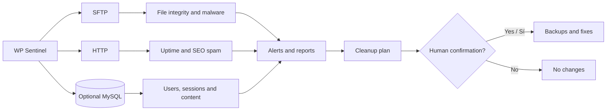

<div align="center">

# 🛡️ WP Sentinel

### External WordPress security monitoring, file integrity and guided cleanup

**Protect multiple websites without installing plugins or agents on monitored servers.**


**[Português](README.md) · [English](README.en.md) · [Español](README.es.md)**

</div>

> [!IMPORTANT]
> **Scans are read-only.** Guided cleanup is a separate operation that may modify files and database records **only after explicit confirmation**. Review the plan and keep reliable backups before applying any fixes.

## 📚 Contents

- [Key features](#section-1)
- [How it works](#section-2)
- [Quick start](#section-3)
- [Overview](#section-4)
- [Installation and configuration](#section-5)
- [Scan frequency and full hashes](#section-6)
- [Docker web dashboard](#section-7)
- [VPS deployment (production)](#section-8)
- [Guided cleanup](#section-9)
- [Reports and audit trail](#section-10)
- [Exit codes](#section-11)
- [Security best practices](#section-12)

<a id="section-1"></a>

## 🌟 Key features

| Feature | What WP Sentinel does |
|:--|:--|
| 🧬 **File integrity** | Compares monitored files with a baseline, including periodic SHA-256 hashing. |
| 🦠 **Malware detection** | Checks for webshells, PHP in suspicious locations, malware markers and malicious drop-ins. |
| 👤 **Accounts and sessions** | Detects new users, privilege changes, suspicious sessions and Application Passwords when database access is available. |
| 🔎 **SEO spam** | Finds hidden external links in public HTML and WordPress/Elementor content. |
| 🌐 **HTTP monitoring** | Checks uptime, redirects and security headers. |
| 🧹 **Guided cleanup** | Creates a plan, requires confirmation, creates backups and flags items for human review. |
| 📁 **Audit trail** | Writes JSONL alerts and daily plain-text technical reports. |
| 🖥️ **React dashboard** | Dockerized web interface sharing the CLI engine and data. |
| 🏢 **Multi-site support** | Configures WordPress websites on different hosts through `.env`. |

<a id="section-2"></a>

## 🧭 How it works



**Workflow:** `Configure sites` → `Run scan` → `Review alerts` → `Inspect cleanup plan` → `Confirm cleanup if needed` → `Scan again`.

<a id="section-3"></a>

## ⚡ Quick start

**Requirements:** Node.js 20+ for local execution; Docker and Docker Compose for the containerized dashboard.

```bash
# 1. Prepare a configuração (Windows PowerShell)
Copy-Item .env.example .env

# 2. Edite o .env com os sites, credenciais e caminhos corretos

# 3. Instale as dependências (execução local)
npm install

# 4. Execute uma verificação inicial
npm run scan:full

# 5. Opcional: inicie o painel em Docker
docker compose up -d --build
```

> [!TIP]
> The first scan records the current state as a baseline; **this does not mean that the state is trustworthy**. Review alerts and validate the environment before using `npm run reset-baseline`.

---

<a id="section-4"></a>

## ✨ Overview

WP Sentinel is an **external, agentless, read-only scanner** for WordPress websites. Site details, paths, SFTP credentials and optional database connections are defined in `.env` rather than hard-coded. Checks include:

- New, modified or removed executable files via SFTP, plus **all** changes in `wp-content/mu-plugins`, regardless of extension.
- Malware marker files in the WordPress root, `wp-content` and `mu-plugins`: `sc_XXXXXX`, `scgXXXXXX`, `z`, `.sc_*`, `.kk_*`, `.gk_*`, `.gt_*`, `.grd_*`, `.sd_*`, `.bt_*`, `.swm_*`, `.rd_*` (up to 64 bytes). These trigger critical alerts per directory. Rules are defined in `src/malware-markers.mjs` and reused by cleanup.
- PHP files in `uploads`, hidden PHP files, dangerous filenames and webshell signatures.
- Drop-ins (`wp-content/db.php`, `advanced-cache.php`, `object-cache.php`) and loose PHP files in `wp-content/cache/` (excluding cache-plugin subdirectories). `src/dropins.mjs` identifies known plugins (W3 Total Cache, WP Super Cache, LiteSpeed, Redis Object Cache, Query Monitor, etc.), suspicious origins and malicious signatures/obfuscation. Malicious files produce critical alerts on every scan; unknown origins produce high alerts when added or changed; recognized benign drop-ins are ignored.
- Login sessions (`session_tokens`): any new session yields a high alert; sessions from the server's own IP or with `WordPress/...` or an empty user agent yield a critical alert. Server IPs are derived from site domains, `SFTP_HOST`, `DB_HOST` and optional `SERVER_IPS`.
- **Hidden SEO spam:** external links in fixed/absolute-positioned blocks with coordinates of −100 px or less. Checks homepage HTML as a browser and as Googlebot, as well as `_elementor_data` and `post_content` for pages, posts and templates in the database. Critical alerts identify the affected pages, widgets and domains. Detection lives in `src/hidden-links.mjs`.
- HTTP availability, cross-domain redirects, security headers and blocking of `xmlrpc.php` and executable PHP in `uploads`.
- Users, privilege changes, Application Passwords, login sessions, new posts, active plugins, configured domains and WP-Cron, when remote MySQL access is permitted.

Monitoring never changes site files or databases. Alerts are saved to `.monitor-data/alerts.jsonl`; **only separately confirmed guided cleanup can make changes**.

> [!NOTE]
> Volatile `wp-content/uploads/sucuri/sucuri-*.php` files are excluded from hash comparisons. All other PHP in `uploads` remains critical, and web execution in that directory is tested every cycle.

<a id="section-5"></a>

## 🚀 Installation and configuration

1. Install **Node.js 20+**.
2. Copy `.env.example` to `.env`.
3. List site prefixes in `SITES`, for example `SITES=STORE,BLOG`. For each prefix, configure `<PREFIX>_NAME`, `<PREFIX>_URL` and `<PREFIX>_REMOTE_ROOT` (the server's WordPress directory containing `wp-config.php`). See the complete example in `.env.example`.
4. Set the default SFTP credentials (`SFTP_*`). Sites hosted elsewhere may override them using `<PREFIX>_SFTP_*`. Prefer read-only credentials where possible.
5. Optional: set `<PREFIX>_DB_*` for database checks. On HostGator/cPanel, allow the monitoring host's IP in **Remote MySQL**. Surround passwords containing `$` or `#` with single quotes.
6. Run `run-scan.cmd` for a one-time scan, or `run-monitor.cmd` for continuous monitoring.

To add or remove a site, update its `.env` block and the `SITES` list. The first scan stores the site's current state. **Do not change `<PREFIX>_KEY` for sites with existing history**: it connects the site to `.monitor-data`.

<a id="section-6"></a>

## ⏱️ Scan frequency and full hashes

| Setting / command | Behavior |
|:--|:--|
| `INTERVAL_SECONDS` (default `300`) | Time between the end of one continuous monitoring cycle and the start of the next. |
| `FULL_HASH_EVERY` (default `24`) | Re-downloads and hashes monitored files every N cycles, catching changes that preserve size and modification time. Other cycles only download new or metadata-changed files. At 300 seconds, a full pass occurs approximately every 4 hours. |
| `npm run scan:full` | Forces a single complete SHA-256 scan, independent of the regular schedule. |
| `MAX_DOWNLOAD_BYTES` (default `8 MiB`) | Files exceeding this size are not downloaded for hashing or inspection. |

The cycle counter also includes `run-scan.cmd` scans. Full-hash passes (including the first scan of a new site) can take over twice as long as regular scans; a long pause while inventorying files is expected. The console indicates when a full-hash scan is in progress.

<a id="section-7"></a>

## 🖥️ Docker web dashboard

The **React SPA** dashboard is built using a multi-stage Docker build (Node.js 22 and optimized static assets). It uses the same CLI engine and local data directories.

### Container commands

```bash
# Build and start the dashboard in the background
docker compose up -d --build

# Follow server, scan and daemon logs
docker compose logs -f

# Check container status
docker compose ps

# Stop the dashboard while preserving volumes and history
docker compose down
```

Dashboard URL: **<http://127.0.0.1:8787>** (or the port set in `PANEL_PORT`).

### Volumes and persistence

`docker-compose.yml` mounts three host locations into the container:

| Mount | Purpose |
|:--|:--|
| `./.env:/app/.env` | Site configuration and credentials; must exist before starting the container. |
| `${DATA_DIR:-./.monitor-data}:/app/.monitor-data` | Integrity history, `trusted-baseline.json`, `state.json`, `alerts.jsonl`, cleanup `backups/`, and `panel-notifications.json`. |
| `${REPORTS_DIR:-./reports}:/app/reports` | Daily TXT technical reports and executive summaries. |

> [!NOTE]
> The CLI scripts (`run-scan.cmd`, `run-monitor.cmd`, `run-cleanup.cmd`) and dashboard share the same data. **Do not run a local continuous monitor at the same time as the dashboard monitor.**

### 🔐 Dashboard security model

- **Local / loopback:** default `PANEL_HOST=127.0.0.1`; only local connections are accepted and no dashboard password is required.
- **Network / VPS:** for any non-loopback `PANEL_HOST` (e.g. `0.0.0.0`), startup is refused unless `PANEL_PASSWORD` is set. Requests are protected using signed HMAC authentication, secure HTTP-only cookies and brute-force rate limiting.

---

<a id="section-8"></a>

## ☁️ VPS deployment (production)

WP Sentinel can run locally or on a Linux VPS/dedicated server (Ubuntu 22.04/24.04 LTS or Debian 12, `amd64` or `arm64`). For always-on monitoring, deploy it on a continuously running host.

### 1. Prepare Linux VPS

Install Docker Engine and the official Docker Compose plugin (the commands below target Ubuntu):

```bash
# Update repositories and install prerequisites
sudo apt-get update && sudo apt-get install -y ca-certificates curl gnupg ufw

# Add the official Docker repository
sudo install -m 0755 -d /etc/apt/keyrings
curl -fsSL https://download.docker.com/linux/ubuntu/gpg | sudo gpg --dearmor -o /etc/apt/keyrings/docker.gpg
sudo chmod a+r /etc/apt/keyrings/docker.gpg
echo "deb [arch=$(dpkg --print-architecture) signed-by=/etc/apt/keyrings/docker.gpg] https://download.docker.com/linux/ubuntu $(. /etc/os-release && echo "$VERSION_CODENAME") stable" | sudo tee /etc/apt/sources.list.d/docker.list > /dev/null

# Install Docker Engine and Compose
sudo apt-get update && sudo apt-get install -y docker-ce docker-ce-cli containerd.io docker-compose-plugin
```

### 2. Copy the project and data

Clone the repository or copy its files into `/opt/wp-sentinel`:

```bash
# Example using Git or rsync
mkdir -p /opt/wp-sentinel
cd /opt/wp-sentinel
git clone <REPOSITORY_URL> .
```

Securely copy the production `.env` and existing `.monitor-data/` history, then restrict permissions:

```bash
# Restrict permissions
chmod 600 .env
chmod -R 700 .monitor-data
```

### 3. Configure production `.env`

```env
# Docker port for reverse proxy
PANEL_HOST=0.0.0.0
PANEL_PORT=8787

# REQUIRED outside loopback: strong dashboard password
PANEL_PASSWORD=REPLACE_WITH_A_STRONG_UNIQUE_PASSWORD

# Automatically start continuous monitoring with the container
MONITOR_AUTOSTART=true
```

### 4. HTTPS reverse proxy (Caddy)

Put **Caddy** in front of WP Sentinel for automatic TLS certificates and WebSocket / Server-Sent Events (SSE) support. Install Caddy with `sudo apt install -y caddy`, then edit `/etc/caddy/Caddyfile`:

```caddy
sentinel.example.com {
    # Forward traffic to container port 8787
    reverse_proxy 127.0.0.1:8787 {
        # Unbuffered SSE streaming
        flush_interval -1
    }

    # Recommended HTTP security headers
    header {
        Strict-Transport-Security "max-age=31536000; includeSubDomains; preload"
        X-Content-Type-Options "nosniff"
        X-Frame-Options "DENY"
        Referrer-Policy "strict-origin-when-cross-origin"
    }
}
```

Reload Caddy:

```bash
sudo systemctl reload caddy
```

### 5. Firewall configuration (UFW)

Allow only required inbound ports. Before enabling UFW, confirm that SSH access is permitted:

```bash
# Allow SSH, HTTP and HTTPS
sudo ufw default deny incoming
sudo ufw default allow outgoing
sudo ufw allow 22/tcp comment 'SSH'
sudo ufw allow 80/tcp comment 'HTTP (Caddy LetEncrypt)'
sudo ufw allow 443/tcp comment 'HTTPS (Caddy)'

# Enable firewall (Sentinel port 8787 stays behind Caddy/localhost)
sudo ufw enable
```

### 6. Allow VPS IP in cPanel Remote MySQL

If WordPress databases are accessed remotely on port 3306:
1. Open **cPanel** for each WordPress hosting account.
2. Navigate to **Databases → Remote MySQL**.
3. Allow the VPS's public static IPv4 address.
4. Without authorization, access may fail with `ER_ACCESS_DENIED_ERROR` (1045).

### 7. Updates and backups

To update WP Sentinel:

```bash
cd /opt/wp-sentinel
git pull
docker compose up -d --build
```

Recommended daily crontab backup of `.monitor-data` and `reports`:

```bash
# Daily backup of .monitor-data and reports
0 3 * * * tar -czf /var/backups/sentinel-backup-$(date +\%F).tar.gz -C /opt/wp-sentinel .monitor-data reports
```

---

<a id="section-9"></a>

## 🧹 Guided cleanup

Run `run-cleanup.cmd` after reviewing scan alerts. The cleanup tool:

1. Creates `.monitor-data/last-cleanup-plan.json`.
2. Separates eligible automatic fixes from items needing manual review.
3. Requires the unique confirmation phrase `LIMPAR-ID-DO-PLANO` before applying changes.
4. Performs database updates inside transactions.

Use `npm run plan` to generate and inspect a plan **without executing cleanup**.

Malicious drop-ins and loose PHP in `wp-content/cache/` may be removed; unknown-origin items require manual review. Every removed file is backed up to `.monitor-data/backups/<plan>-<site>-files/` (the actual on-disk folder name follows the implementation's localized naming convention).

Database cleanup may remove malware options (`sc_*`, hex-named copies and `wpeditor_*`), malicious plugins left in the active plugins list and the **Site Optimizer Bridge** snippet from Code Snippets. Backups go to `.monitor-data/backups/`. A user is eligible for automatic deletion only if trustworthy baseline user data exists; otherwise it requires human review.

Optional per-site cutoffs `<PREFIX>_SPAM_SINCE_POST` and `<PREFIX>_SPAM_SINCE_PAGE` allow deleting posts/pages created after specified dates as spam. **Set these only when you have verified there is no legitimate content in that period.**

Automatic fixes are restricted to high-confidence indicators: newly introduced malicious files, newly added users, Application Passwords, public registration settings, `wpse_user_id`, known malicious cron hooks, tampered domains and malware marker files (up to 64 bytes) in root, `wp-content` and `mu-plugins`. Cleanup also revokes **all login sessions** (`session_tokens`) for the affected sites, including legitimate ones; users must sign in again. Pre-existing baseline files, new posts and unfamiliar new cron hooks are never automatically removed because they may be legitimate.

### Hidden external-link SEO spam

When hidden links are found, guided cleanup:

1. Backs up original `_elementor_data`, `post_content`, Elementor cache and affected revisions under `.monitor-data/backups/<plan>-<site>-*.json`.
2. Removes only the hidden blocks without unnecessarily re-encoding the surrounding WordPress content; completely empty attacker-created HTML widgets are removed.
3. Deletes affected `_elementor_element_cache` entries (Elementor rebuilds them).
4. Deletes revisions still containing hidden links so they cannot be inadvertently restored.
5. Rechecks the published HTML as a browser and as Googlebot.

Pages that cannot be edited safely are left untouched and sent for manual review. After cleanup, run `run-scan.cmd` again.

The initial baseline reflects whatever was on the server at first scan. Malicious signatures are still detected. **Only use `npm run reset-baseline` after independently confirming that the remote state is trustworthy**; this command also replaces the trusted baseline used for cleanup.

<a id="section-10"></a>

## 📄 Reports and audit trail

Every one-off scan and cleanup adds a section to `reports/REPORT-DD.MM.AA.txt`, using **Brasília local date**; later events on the same day add numbered sections (see the example `reports/REPORT-23.10.26.txt`).

- `run-scan.cmd`: always writes a report for each site's files, HTTP, database and alerts.
- `run-monitor.cmd`: reports only cycles with high or critical alerts, avoiding noisy five-minute reports.
- `run-cleanup.cmd`: always reports, even for an empty plan, canceled confirmation or interruption; includes per-site actions, page checks, manual review and backups. `npm run plan` does not write a report.

Reports can contain usernames, IP addresses and server paths. Keep them private. `reports/` is ignored by Git.

<a id="section-11"></a>

## 🔢 Exit codes

| Code | Meaning |
|:--|:--|
| `0` | No high or critical findings. |
| `1` | High-severity alert. |
| `2` | Critical alert or general scan failure. |


<a id="section-12"></a>

## 🔐 Security best practices

- **Protect credentials:** never commit `.env`; grant the least possible SFTP/MySQL permissions and restrict configuration file access.
- **Protect dashboard exposure:** use HTTPS and authentication behind a reverse proxy on a VPS and ensure the Docker port binding is properly restricted.
- **Protect sensitive audit data:** `.monitor-data/` and `reports/` may contain IP addresses, user details and server paths.
- **Review findings before cleanup:** legitimate changes may be flagged; verify the plan and backup availability.
- **Avoid concurrent monitoring:** do not run two continuous monitors against shared data directories.
- **Validate baselines:** the initial remote state may already be compromised.

<details>
<summary><strong>📌 Quick file and directory reference</strong></summary>

| Path | Purpose |
|:--|:--|
| `.env` | Secret site configuration and credentials. |
| `.env.example` | Configuration template. |
| `.monitor-data/alerts.jsonl` | Structured alert feed. |
| `.monitor-data/trusted-baseline.json` | Trusted baseline for analysis and cleanup. |
| `.monitor-data/state.json` | Persisted runtime state. |
| `.monitor-data/last-cleanup-plan.json` | Most recent cleanup plan. |
| `.monitor-data/backups/` | Cleanup backups. |
| `reports/REPORT-DD.MM.AA.txt` | Daily Brasília-time reports. |
| `src/malware-markers.mjs` | Malware marker signatures. |
| `src/dropins.mjs` | Drop-in classification. |
| `src/hidden-links.mjs` | Hidden-link detection. |

</details>

---

<div align="center">

**WP Sentinel** · External monitoring · Integrity · Auditing · Guided cleanup

<sub>Operations documentation — keep credentials and reports private.</sub>

</div>
